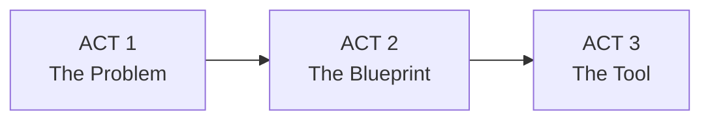

# M-GRAT: Turning an Overgrown Knowledge Base into a 15-Minute Growth Conversation

> **One-liner:** Designed an internal enablement tool that helps Maximo sellers guide customers to use more of what they already own, so customers see more value from their investment.

---

## Project Overview

| Attribute | Details |
|---|---|
| **Role** | Lead UX & Visual Designer (flow design, logic simulation, Carbon UI, data visualization, PDF output) |
| **Team** | 1 Product Owner / Lead Designer, 2 Full-Stack Engineers, Maximo Strategy & Sales SMEs |
| **Audience** | Maximo sellers (internal enablement), used with customers |
| **Platform** | Responsive web app, offline single-file HTML, print-ready PDF |
| **Format** | Morphing split-stage case study: sticky 50% animated canvas, 50% minimal text |

## Business Context

Company-level ALM results from the Q4 2026 All Hands, reported for Q3 2026. These describe the ALM business overall, not M-GRAT. Use them as framing only, not as M-GRAT outcomes.

| Metric | Reported value | Reported by |
|---|---|---|
| ALM revenue growth | 5% | Daniel Basto |
| Maximo revenue growth | 11% | Daniel Basto |
| New SaaS annual contract value growth | 88% | Daniel Basto |
| Combined transactional + SaaS revenue | Above $50M, first Q3 to pass this level | Theo Winkelmann |
| Q3 performance | Best third quarter in four years | Theo Winkelmann |

**Context:** Leadership framed the year around scaling AI adoption, accelerating SaaS growth, and MAS 9.2 adoption. M-GRAT supports the same goal of helping customers get more value from what they already own.

## Format Rules

1. **Text is minimal.** Each transition gets 1–2 sentences, no more.
2. **The graphic tells the story.** If a point can be shown, don't write it.
3. **One canvas, no cuts.** Every scene morphs from the previous one.

---

## ACT 1: The Problem

*An overgrown knowledge base. Customers leave value unused.*

| Beat | Canvas (left) | Text (right, max 2 sentences) |
|---|---|---|
| 1.1 | A knowledge base sprawls across the canvas: documents, decks and pages multiply until the stage is crowded. | Sellers had a huge knowledge base and no clear path through it. Preparing one customer conversation took days. |
| 1.2 | Three customer meters appear: **AppPoints**, **Entitlement**, **Usage**. Each fills only a small amount while the unused remainder glows. | Customers were underusing what they'd already paid for. |
| 1.3 | The unused portion pulses, then collapses into a single target: *Use more, get more value.* | **Goal:** Help customers use more of Maximo, so their investment feels worth it. |

**Transition out:** The tangle of documents pulls into straight lines and begins to form a grid.

---

## ACT 2: The Blueprint

*From a structure on paper, to Maximo World, to the Advisory Council.*

| Beat | Canvas (left) | Text (right, max 2 sentences) |
|---|---|---|
| 2.1 | Straight lines settle into an isometric blueprint of the full flow: objectives, obstacles, milestones, growth appetite. | I mapped the whole conversation on one blueprint before drawing a single screen. |
| 2.2 | The blueprint lifts into the **Maximo World version (v1)**: the first working prototype, shown as a rough, early UI. | The first version went to Maximo World for real feedback. |
| 2.3 | Feedback notes (`[feedback 1]`, `[feedback 2]`, `[feedback 3]`) drift onto v1. The UI reshapes itself in response and morphs into **v2**. | `[One sentence on what the feedback changed.]` |
| 2.4 | A location pin drops on **Lowell, US**. v2 sits centered under a banner: *Maximo Advisory Council*. | I presented v2 to the Maximo Advisory Council in Lowell. |

**Transition out:** The canvas fades to full black. v2's pieces fall away, ready to rebuild.

---

## ACT 3: The Tool

*Full black screen. The product assembles itself.*

| Beat | Canvas | Text (max 2 sentences) |
|---|---|---|
| 3.1 | **Full-screen black.** UI fragments (header, cards, buttons, nav) fly in and assemble the **landing page**. The page lights up once complete. | *(none, let the build play)* |
| 3.2 | The landing page **zooms out and slides into the left half** of the screen. | An internal enablement tool for sellers. *(text fades in on the right half)* |
| 3.3 | Camera **zooms into the features and use cases** section. Cards highlight one by one. | `[One sentence: what sellers can do with it.]` |
| 3.4 | Zoom continues into the **questions**. The pace slows: one question at a time, answers tapped *Met / Unmet / Unknown*. Unknown glows amber and drops into a follow-up drawer. | Customers can say "I don't know" without hurting their score. Sellers get a follow-up list instead. |
| 3.5 | The remaining questions **finish in a burst**, answered rapid-fire, then the progress bar completes. | *(none, let the burst land)* |
| 3.6 | Screen transitions to the **report**. The 8-axis radar blooms (current state vs. target), and the 5-point action plan cards slide in beneath it. | The report turns answers into a prioritized 5-point plan, ready for the customer conversation. |
| 3.7 | The report folds into the **PDF brief** and settles, with outcome tiles rising beside it: `[XX%]` faster prep, `[XX%]` completion. | `[Closing outcome in 1 sentence.]` |

---

## Animation Notes

| Principle | Direction |
|---|---|
| **Scroll-driven** | Each beat maps to a scroll position. Scrubbing back reverses the animation. |
| **Persistent canvas** | Only Act 3.1 breaks the split layout (full black). It returns to 50/50 at 3.2. |
| **Pacing** | Slow for the problem and blueprint. Fast and rhythmic for the question burst (3.5). |
| **Accessibility** | Support `prefers-reduced-motion` with static frames per beat. Every beat's text stays readable without the animation. |

## Open Items

* Fill in all `[placeholders]` (feedback summary, Act 3.3 sentence, outcome metrics) with real data. Don't publish estimates. The All Hands figures in Business Context are not substitutes for the M-GRAT outcome metrics.
* **Future phase:** The Data Readiness dashboard I'm working on now. Decide whether it becomes an epilogue after 3.7, or a separate follow-up case study.

## Facts to Keep Accurate

* Scoring covers **8 weighted dimensions** and produces a **5-point action plan**.
* The "Unknown" state carries **no score penalty** and routes items to a follow-up list.
* The tool ships as a web app, an **offline single-file HTML** with no external network requests, and a **print-ready PDF** brief.
