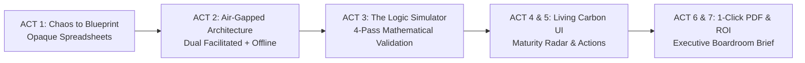

# M-GRAT: Transforming Enterprise Maximo Growth from Subjective Guesswork into Data-Driven Action

> **One-liner:** Designed a dual-modality readiness assessment engine and logic simulator that cut discovery time from days to 15 minutes, validated complex scoring rules, and generated instant, boardroom-ready Maximo growth roadmaps.

---

## 📌 Project Overview

| Attribute | Details |
|---|---|
| **Role** | **Lead UX & Visual Designer** (Systems architecture, logic simulation, Carbon design system UI, data visualization, print/PDF engineering) |
| **Team** | 1 Lead Designer (me), 1 Product Owner / Lead Designer, 2 Full-Stack Engineers, Maximo Strategy & Sales SMEs |
| **Platform** | Responsive Web App + Standalone Air-Gapped Offline HTML + Print-Optimized PDF |
| **Format** | **Morphing Split-Stage Case Study** (Sticky 50% Living Prototype Canvas + 50% Scrollytelling Story Stream) |



---

## 💡 Key Highlights & Target Impact

* **`[XX% reduction]`** in assessment prep and synthesis time for enterprise account teams.
* **`[XX% completion rate]`** across facilitated and self-serve client sessions.
* **Zero-dependency offline delivery**: Passed strict enterprise infosec audits with a single-file, client-side bundle (0 external network requests).
* **Novel Logic Prototyping**: Built an interactive Journey Simulator to stress-test multi-pass algorithms before engineering implementation.

---

## 🎬 The Interactive Split-Stage Experience

```
┌───────────────────────────────────────────┬───────────────────────────────────────────┐
│        LEFT CANVAS (50% STICKY STAGE)     │      RIGHT STREAM (50% SCROLL STORY)      │
├───────────────────────────────────────────┼───────────────────────────────────────────┤
│  Morphs dynamically as you scroll:        │  Concise design narrative:                │
│  • Glitch Grid ➔ Technical Blueprint      │  • The $100M Discovery Problem            │
│  • Dual-Modality Air-Gapped Node Map      │  • Security-First Architecture            │
│  • Live Interactive Logic Simulator       │  • When the Algorithm Lied (The Math Fix) │
│  • Living Carbon UI & 8-Axis Radar        │  • Turning Hesitation into Data (Unknown) │
│  • 3D Unfolding PDF Strategy Brief        │  • The Executive Artifact & Hard ROI      │
└───────────────────────────────────────────┴───────────────────────────────────────────┘
```

---

### ACT 1: The Status Quo — From Spreadsheet Chaos to Blueprint

#### 🖥️ Left Stage (Visual Morph)
* Starts as a chaotic, glitching 50-row Excel grid riddled with `#VALUE!` formulas and dense notes.
* As the user scrolls, an animated laser-sweep clears the noise, drawing a crisp, isometric blueprint wireframe of the 4-step diagnostic wizard.

#### 📖 Right Narrative (Story Stream)
**3 Days of Prep for a 30-Minute Meeting**

Enterprise sellers guiding clients through the Maximo Application Suite (MAS) faced an opaque, fragmented process:
* **The Manual Grind:** Discovery lived in 50+ row spreadsheets and unstructured slide decks. Prepping a custom roadmap took account leaders 2–3 days of manual synthesis.
* **The Client Interrogation:** Customers were overwhelmed by 40+ technical feature lists without understanding how individual milestones tied to operational ROI.

> *"We spent more time formatting slides and debating formula weights than talking strategy with clients."* — Enterprise Account Executive

---

### ACT 2: System Architecture — The Air-Gapped Dual Mode

#### 🖥️ Left Stage (Visual Morph)
* The wireframe splits into two animated interactive data tracks:
  1. **Facilitated Co-Pilot Mode** (Dual-pane seller layout with live screen-share notes drawer).
  2. **Standalone Self-Serve Mode** (Distraction-free client wizard).
* A live network telemetry HUD monitors the canvas: `[HTTP Requests: 0]`, `[Data Leaks: None]`, `[Mode: Air-Gapped Local Storage]`.

#### 📖 Right Narrative (Story Stream)
**Designing for Zero-Trust Enterprise Infosec**

Regulated clients (utilities, defense, nuclear, oil & gas) flatly rejected third-party cloud survey forms due to strict data governance.

I architected a single codebase serving two distinct runtime realities:
1. **Live Facilitated Web App:** Optimized for Zoom/Webex screen shares with dynamic speaker notes and real-time calculation.
2. **Zero-Dependency Standalone Bundle:** A self-contained `.html` file containing inlined CSS, SVGs, and JavaScript. Clients run it locally in any browser with zero network access and complete privacy.

---

### ACT 3: The Logic Crisis — When the Algorithm Lied

#### 🖥️ Left Stage (Visual Morph)
* The canvas transforms into the **Interactive Journey Simulator Debugger**:
  * Sliders on the left control dimension readiness (Asset Management, Predict, Reliability).
  * Center nodes visualize real-time dependency checks.
  * Right panel displays the calculated maturity stage.
* **Interactive Demo:** Readers can toggle an edge-case profile (*High Predict score, missing baseline Asset Health*) to see the simulator catch and resolve a false-positive stage rating.

#### 📖 Right Narrative (Story Stream)
**Logic Prototyping as UX Design**

Static wireframes cannot validate multi-pass scoring math. 

Early testing revealed a major flaw: clients answering advanced IoT questions affirmatively were being assigned "Leader" status, even when foundational asset tracking was missing.

To de-risk the product before engineering, I designed and coded an internal **Journey Simulator**:
* **Pass 1:** Resolves raw milestone states across **8 weighted dimensions**.
* **Pass 2:** Calculates the overall Maturity Index and enforces prerequisite stage gates.
* **Pass 3 & 4:** Runs tie-breaking logic across identified obstacles to output a prioritized 5-point action plan.

> **Result:** Domain SMEs stress-tested 100+ diagnostic variations in the simulator, catching 6 critical logic flaws before release.

---

### ACT 4: Interface Craft — Carbon Design System & The "Unknown" State

#### 🖥️ Left Stage (Visual Morph)
* The simulator resolves into the **Living Carbon UI Prototype**:
  * Fully clickable 4-step flow: *Objectives ➔ Obstacles ➔ Milestones ➔ Growth Appetite*.
  * Clicking `UNKNOWN` triggers a subtle amber light and routes the item directly to the seller's discovery agenda drawer without penalizing the overall maturity index.

#### 📖 Right Narrative (Story Stream)
**Turning Hesitation into Sales Discovery**

Enterprise buyers often don't know the exact technical state of every subsystem. In traditional surveys, forcing a binary "Yes/No" creates false data or user drop-off.

I designed a first-class **"Unknown" State**:
* **Zero Score Penalty:** Marking a capability as Unknown does not degrade the customer's maturity score.
* **Discovery Signals:** Automatically clusters Unknowns into a dedicated follow-up section on the final report, giving sellers an instant talking agenda for technical SME calls.
* **Carbon Craft:** Built strictly on the IBM Carbon Design System (2x grid, semantic tokens, WCAG 2.2 AA contrast, and keyboard navigation).

---

### ACT 5: Data Visualization — The 8-Axis Maturity Radar

#### 🖥️ Left Stage (Visual Morph)
* The prototype transitions into the diagnostic results view.
* An interactive **8-Axis Maturity Radar Chart** blooms into view, rendering the customer's *Current State* (solid IBM Blue) against their *Target Growth Appetite* (dashed Cyan boundary), accompanied by scannable **Action Cards**.

#### 📖 Right Narrative (Story Stream)
**Translating Abstract Math into Clear Visual Strategy**

Raw percentage scores fail to move executive buyers. The diagnostic needed to show not just *where they stand*, but *where the gaps exist* relative to their specific business ambitions.

* **Dual-Layer Polygon:** Compares baseline capabilities with target horizons across all 8 Maximo vectors.
* **Action Card Hierarchy:** Every recommended capability is paired with prerequisite dependencies, target Maximo modules, and measurable operational outcomes (e.g., *"Reduce unplanned downtime by 18%"*).

---

### ACT 6: The Physical Artifact — The 1-Click Executive PDF Brief

#### 🖥️ Left Stage (Visual Morph)
* The browser interface folds and rotates in 3D perspective into an **Executive Strategy Brief PDF**.
* Visual callouts highlight print stylesheet details: zero-orphan headers, high-contrast vector charts, and customized executive cover layout.

#### 📖 Right Narrative (Story Stream)
**Designing for the Executive Boardroom**

In enterprise software sales, the browser UI is only half the journey. The ultimate decision-maker is often an executive who was never on the call.

I engineered the `@media print` stylesheet as a first-class screen:
* **One-Click Generation:** Transforms dynamic DOM states into a high-res, multi-page PDF strategy brief directly in the browser.
* **Zero Cloud Dependency:** Generates client-side without external rendering microservices.
* **Executive Scannability:** Formatted specifically for C-suite briefings, giving sellers a presentation-ready deliverable within seconds of finishing discovery.

---

### ACT 7: Business Outcomes & Reflection

#### 🖥️ Left Stage (Visual Morph)
* The PDF rests in 3D perspective while glowing animated KPI counter tiles elevate to the foreground:
  * **`[XX%]`** Faster Assessment Delivery
  * **`[XX%]`** Session Completion Rate
  * **`0`** Security Objections Across Enterprise Accounts

#### 📖 Right Narrative (Story Stream)
**Outcomes & Retrospective**

M-GRAT transformed Maximo growth conversations from subjective guesswork into structured, repeatable account acceleration.

```
┌─────────────────────────────────────────────────────────────────────────┐
│                           MEASURED OUTCOMES                             │
├───────────────────────────┬─────────────────────────────────────────────┤
│ ⚡ Time-to-Value          │ Cut discovery synthesis time from days to   │
│                           │ under 15 minutes.                           │
├───────────────────────────┼─────────────────────────────────────────────┤
│ 🛡️ 100% Infosec Approval  │ Zero security friction across heavily       │
│                           │ regulated enterprise accounts.              │
├───────────────────────────┼─────────────────────────────────────────────┤
│ 🎯 Actionable Roadmaps    │ 100% of completed sessions generated        │
│                           │ prioritized 5-point Maximo action plans.    │
└───────────────────────────┴─────────────────────────────────────────────┘
```

<<<<<<< HEAD
#### What I Learned
1. **Logic prototyping is a core UX discipline:** When designing data-driven diagnostic tools, validating algorithms with interactive simulators is just as critical as visual wireframing.
2. **Treat print as a primary viewport:** Designing the end-state artifact (the PDF that leadership reads) backward into the web experience ensured every input served an executive outcome.
=======
### User Pain Points
* **For Sellers / Account Leaders:** Every rep ran discovery differently. Capturing responses during live calls required juggling disparate notes, and translating findings into a polished client presentation took days of manual effort.
* **For Enterprise Clients:** Customers felt interrogated by long lists of technical features without understanding *why* specific milestones mattered to their business outcomes.

---

## 2. THE AFTER — The Transformed Growth Experience

We designed **M-GRAT (Maximo Growth Readiness Assessment Tool)** — a cohesive, interactive assessment platform that unifies discovery, intelligent scoring, and actionable roadmapping into a seamless experience.

### What Shipped:
1. **Dual-Modality Flexibility:**
   * **Facilitated Mode (Live Calls):** A streamlined interface allowing sellers to co-pilot the assessment with clients on screen sharing.
   * **Self-Serve Mode (Async / Offline):** A single, bundled offline `.html` file that clients can run locally in their browser without internet access, logins, or tracking concerns.
2. **Dynamic Milestone Scoring Engine:** Evaluates customer readiness across **8 weighted dimensions** (Asset Management, Monitoring, Predictive Maintenance, Reliability, etc.) and automatically computes an **Overall Maturity Index** and adoption stage gating (from Foundation to Continuous Optimization).
3. **Instant, Presentation-Ready Growth Report:** Generates an immediate visual breakdown of maturity gaps, categorized obstacles, and a prioritized 5-point action plan.
4. **Print-First PDF Deliverable:** A dedicated `@media print` layout that transforms the browser view into an executive-ready PDF strategy brief with a single click.

// Need to add in for the future phase (Ideally what I'm working on) - in this case it's the Data Readiness dashboard and how the readiness assessment can potentially help. Bob - need to figure out how that will fit the workflow itself.

---

## 3. THE BRIDGE — Process, Prototyping & Logic Validation

```
Discovery & Framing ──► Dual-Delivery UX ──► Journey Simulator ──► Visual & Carbon Design ──► Validation
```

### Step 1: Mapping the Discovery Workflow
We began by analyzing how sellers and client technical directors interact during quarterly business reviews and expansion conversations.

* **Key Insight:** Enterprise accounts rarely have all stakeholders in the room at once. The tool couldn't just be an internal CRM form; it had to be customer-facing, high-trust, and accessible both synchronously and asynchronously.

---

### Step 2: Designing the Dual-Delivery Architecture
To support both seller-led meetings and client self-discovery without maintaining two separate codebases, we architected a modular UI flow:

```
[ Question Flow: Objectives ➔ Obstacles ➔ Milestones ➔ Growth Appetite ]
                                │
        ┌───────────────────────┴───────────────────────┐
        ▼                                               ▼
Facilitated Web App                            Self-Serve Standalone
• Live seller guidance                         • Zero network calls
• Interactive stepper & notes                  • 100% inlined assets
• Immediate report transition                  • Client-side PDF export
```

* **Cognitive Load Reduction:** Structured the flow into 4 progressive sections: *Objectives*, *Obstacles*, *Milestone Readiness* (Met / Unmet / Unknown), and *Growth Appetite*.
* **Defensive "Unknown" State:** Encouraged clients to mark capabilities as "Unknown" without penalty, providing sellers with clear discovery signals for follow-up conversations.

---

### Step 3: The Journey Simulator — Prototyping & Validating Complex Logic
*One of the most complex design challenges was ensuring the underlying scoring algorithm produced credible, coherent recommendations across hundreds of potential question combinations.*

```
Raw Answers (MET / UNMET / UNKNOWN)
  │
  ▼  [Pass 1: Milestone State Resolution]
Dimension Scores (8 Weighted Vectors)
  │
  ▼  [Pass 2: Overall Maturity Index & Stage Gating]
Target Stage Gap Analysis
  │
  ▼  [Pass 3 & 4: 5-Key Action Prioritization + Obstacle Tie-Breaking]
Personalized Action Plan & Growth Roadmap
```

#### Why We Built the Journey Simulator
* **The Logic Risk:** A multi-pass scoring engine (calculating dimension weights, gating rules, and obstacle tie-breaking) cannot be validated with static wireframes.
* **The Simulator Solution:** We designed an interactive internal **Journey Simulator** artifact. This allowed designers, product leadership, and domain SMEs to:
  1. Toggle question states and test edge-case client profiles in real-time.
  2. Visually inspect how individual answers shifted dimension bars and maturity stages.
  3. Validate that generated action recommendations felt relevant, actionable, and mathematically sound before engineering finalized the client-facing UI.

---

### Step 4: Visual Design & Data Visualization
Working with the **IBM Carbon Design System**, we designed an enterprise-grade visual hierarchy:

* **Maturity Radar & Stage Rails:** Translated abstract scores into intuitive maturity indicators so clients could see their current stage vs. their target ambition at a glance.
* **Action Cards:** Designed clear, scannable cards pairing recommended Maximo capabilities with explicit business outcomes and prerequisites.
* **Print & Export UX:** Iterated heavily on print stylesheets (`@media print`) to eliminate page-break orphan headers, ensure high-contrast chart rendering, and provide a clean cover-to-summary document flow.

---

## 🎯 Key Portfolio Focus Areas (Why This Project Stands Out)

When presenting this case study in interviews or on your portfolio, emphasize these three core narratives:

1. **System & Logic Design (Beyond Screen Layouts):** Highlight how you tackled the multi-pass scoring logic and utilized the **Journey Simulator** to validate recommendations before shipping.
2. **Solving Enterprise Constraints (Offline & Infosec):** Showcase your design thinking around enterprise privacy by delivering a self-contained offline standalone tool alongside the web version.
3. **End-to-End Product Craft:** Show the full arc from qualitative seller discovery, interaction architecture, and Carbon design system integration to print/PDF delivery.

---

## 📊 Outcomes & Reflection

### Impact & Results *(Placeholders ready for final metrics)*
* **`[XX+]`** Account assessments conducted across enterprise Maximo clients.
* **`[XX% faster]`** time-to-report generation compared to legacy manual decks.
* **`[Qualitative Seller Quote]:`** *"M-GRAT turned our 2-hour discovery meetings into focused, 30-minute strategic alignment sessions with clear next steps."*

### Key Learnings
* **Logic prototyping is UX design:** In data-driven assessment tools, validating the reasoning engine with interactive prototypes is just as crucial as validating visual affordances.
* **Design for the final deliverable:** The ultimate user artifact for enterprise buyers is often the PDF shared with leadership; treating the print stylesheet as a first-class screen was essential to project success.
>>>>>>> 7696a787a4c9d8e0c4aee60a56c02e733513b1d9
