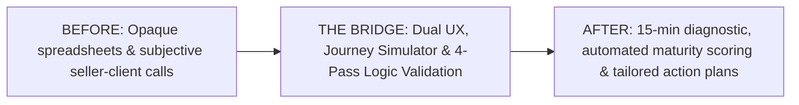

# M-GRAT: Transforming Enterprise Maximo Growth from Subjective Guesswork into Data-Driven Action

> **One-liner:** Designed and validated a dual-mode (facilitated + zero-dependency self-serve) readiness assessment tool and logic simulator that empowers IBM sellers and Maximo customers to diagnose adoption maturity and generate personalized growth roadmaps.

---

## 📌 Project Overview

| Attribute | Details |
|---|---|
| **Role** | **UX & Visual Designer** (Interaction flows, visual design, Carbon design system styling, data visualization, print/PDF UX) |
| **Team** | Design Squad (Collaborating with peer designers and a Lead Designer acting as Product Owner), Engineering, Maximo Strategy & Sales SMEs |
| **Project Type** | Enterprise Enablement Tool (Internal seller enablement + Customer-facing growth platform) |
| **Platform** | Responsive Web App + Standalone zero-dependency offline HTML + Print-optimized PDF |
| **Format** | **Before / After / Bridge** (Process-led case study for public portfolio) |



---

## 💡 Key Highlights & Target Impact

* **`[XX% reduction]`** in assessment preparation and delivery time for enterprise account teams.
* **`[XX% completion rate]`** across self-serve and facilitated client sessions.
* **Zero-dependency offline delivery**: Eliminated enterprise infosec friction by shipping a single, self-contained HTML bundle that runs locally without cloud data transfer.
* **Journey Simulator Artifact**: Designed a simulation framework to validate complex multi-dimensional scoring logic before shipping.

---

## 1. THE BEFORE — The Fragmented Status Quo

### The Business & User Problem
Maximo Application Suite (MAS) is a comprehensive enterprise platform spanning asset management, predictive maintenance, reliability engineering, and IoT analytics. Despite significant investment, account teams faced critical bottlenecks when guiding customers toward platform maturity:

```
┌─────────────────────────────────────────────────────────────────────────┐
│                       THE STATUS QUO FRICTION                           │
├───────────────────────────┬─────────────────────────────────────────────┤
│ 🚩 Opaque & Inconsistent  │ Growth conversations relied on unstructured │
│    Discovery              │ slide decks and 50+ row Excel spreadsheets. │
├───────────────────────────┼─────────────────────────────────────────────┤
│ 🚩 Security & Privacy     │ Enterprise clients in regulated industries │
│    Friction               │ hesitated to enter sensitive operational   │
│                           │ data into third-party cloud survey tools.   │
├───────────────────────────┼─────────────────────────────────────────────┤
│ 🚩 Disconnected Outputs   │ Assessments produced raw scores rather than │
│                           │ prioritized, tactical "what to do next"     │
│                           │ milestone action plans.                     │
└───────────────────────────┴─────────────────────────────────────────────┘
```

### User Pain Points
* **For Sellers / Account Leaders:** Every rep ran discovery differently. Capturing responses during live calls required juggling disparate notes, and translating findings into a polished client presentation took days of manual effort.
* **For Enterprise Clients:** Customers felt interrogated by long lists of technical features without understanding *why* specific milestones mattered to their business outcomes.

---

## 2. THE AFTER — The Transformed Growth Experience

We designed **M-GRAT (Maximo Growth Readiness Assessment Tool)** — a cohesive, interactive assessment platform that unifies discovery, intelligent scoring, and actionable roadmapping into a seamless experience.

### What Shipped:
1. **Dual-Modality Flexibility:**
   * **Facilitated Mode (Live Calls):** A streamlined interface allowing sellers to co-pilot the assessment with clients on screen sharing.
   * **Self-Serve Mode (Async / Offline):** A single, bundled offline `.html` file that clients can run locally in their browser without internet access, logins, or tracking concerns.
2. **Dynamic Milestone Scoring Engine:** Evaluates customer readiness across **8 weighted dimensions** (Asset Management, Monitoring, Predictive Maintenance, Reliability, etc.) and automatically computes an **Overall Maturity Index** and adoption stage gating (from Foundation to Continuous Optimization).
3. **Instant, Presentation-Ready Growth Report:** Generates an immediate visual breakdown of maturity gaps, categorized obstacles, and a prioritized 5-point action plan.
4. **Print-First PDF Deliverable:** A dedicated `@media print` layout that transforms the browser view into an executive-ready PDF strategy brief with a single click.

// Need to add in for the future phase (Ideally what I'm working on) - in this case it's the Data Readiness dashboard and how the readiness assessment can potentially help. Bob - need to figure out how that will fit the workflow itself.

---

## 3. THE BRIDGE — Process, Prototyping & Logic Validation

```
Discovery & Framing ──► Dual-Delivery UX ──► Journey Simulator ──► Visual & Carbon Design ──► Validation
```

### Step 1: Mapping the Discovery Workflow
We began by analyzing how sellers and client technical directors interact during quarterly business reviews and expansion conversations.

* **Key Insight:** Enterprise accounts rarely have all stakeholders in the room at once. The tool couldn't just be an internal CRM form; it had to be customer-facing, high-trust, and accessible both synchronously and asynchronously.

---

### Step 2: Designing the Dual-Delivery Architecture
To support both seller-led meetings and client self-discovery without maintaining two separate codebases, we architected a modular UI flow:

```
[ Question Flow: Objectives ➔ Obstacles ➔ Milestones ➔ Growth Appetite ]
                                │
        ┌───────────────────────┴───────────────────────┐
        ▼                                               ▼
Facilitated Web App                            Self-Serve Standalone
• Live seller guidance                         • Zero network calls
• Interactive stepper & notes                  • 100% inlined assets
• Immediate report transition                  • Client-side PDF export
```

* **Cognitive Load Reduction:** Structured the flow into 4 progressive sections: *Objectives*, *Obstacles*, *Milestone Readiness* (Met / Unmet / Unknown), and *Growth Appetite*.
* **Defensive "Unknown" State:** Encouraged clients to mark capabilities as "Unknown" without penalty, providing sellers with clear discovery signals for follow-up conversations.

---

### Step 3: The Journey Simulator — Prototyping & Validating Complex Logic
*One of the most complex design challenges was ensuring the underlying scoring algorithm produced credible, coherent recommendations across hundreds of potential question combinations.*

```
Raw Answers (MET / UNMET / UNKNOWN)
  │
  ▼  [Pass 1: Milestone State Resolution]
Dimension Scores (8 Weighted Vectors)
  │
  ▼  [Pass 2: Overall Maturity Index & Stage Gating]
Target Stage Gap Analysis
  │
  ▼  [Pass 3 & 4: 5-Key Action Prioritization + Obstacle Tie-Breaking]
Personalized Action Plan & Growth Roadmap
```

#### Why We Built the Journey Simulator
* **The Logic Risk:** A multi-pass scoring engine (calculating dimension weights, gating rules, and obstacle tie-breaking) cannot be validated with static wireframes.
* **The Simulator Solution:** We designed an interactive internal **Journey Simulator** artifact. This allowed designers, product leadership, and domain SMEs to:
  1. Toggle question states and test edge-case client profiles in real-time.
  2. Visually inspect how individual answers shifted dimension bars and maturity stages.
  3. Validate that generated action recommendations felt relevant, actionable, and mathematically sound before engineering finalized the client-facing UI.

---

### Step 4: Visual Design & Data Visualization
Working with the **IBM Carbon Design System**, we designed an enterprise-grade visual hierarchy:

* **Maturity Radar & Stage Rails:** Translated abstract scores into intuitive maturity indicators so clients could see their current stage vs. their target ambition at a glance.
* **Action Cards:** Designed clear, scannable cards pairing recommended Maximo capabilities with explicit business outcomes and prerequisites.
* **Print & Export UX:** Iterated heavily on print stylesheets (`@media print`) to eliminate page-break orphan headers, ensure high-contrast chart rendering, and provide a clean cover-to-summary document flow.

---

## 🎯 Key Portfolio Focus Areas (Why This Project Stands Out)

When presenting this case study in interviews or on your portfolio, emphasize these three core narratives:

1. **System & Logic Design (Beyond Screen Layouts):** Highlight how you tackled the multi-pass scoring logic and utilized the **Journey Simulator** to validate recommendations before shipping.
2. **Solving Enterprise Constraints (Offline & Infosec):** Showcase your design thinking around enterprise privacy by delivering a self-contained offline standalone tool alongside the web version.
3. **End-to-End Product Craft:** Show the full arc from qualitative seller discovery, interaction architecture, and Carbon design system integration to print/PDF delivery.

---

## 📊 Outcomes & Reflection

### Impact & Results *(Placeholders ready for final metrics)*
* **`[XX+]`** Account assessments conducted across enterprise Maximo clients.
* **`[XX% faster]`** time-to-report generation compared to legacy manual decks.
* **`[Qualitative Seller Quote]:`** *"M-GRAT turned our 2-hour discovery meetings into focused, 30-minute strategic alignment sessions with clear next steps."*

### Key Learnings
* **Logic prototyping is UX design:** In data-driven assessment tools, validating the reasoning engine with interactive prototypes is just as crucial as validating visual affordances.
* **Design for the final deliverable:** The ultimate user artifact for enterprise buyers is often the PDF shared with leadership; treating the print stylesheet as a first-class screen was essential to project success.
